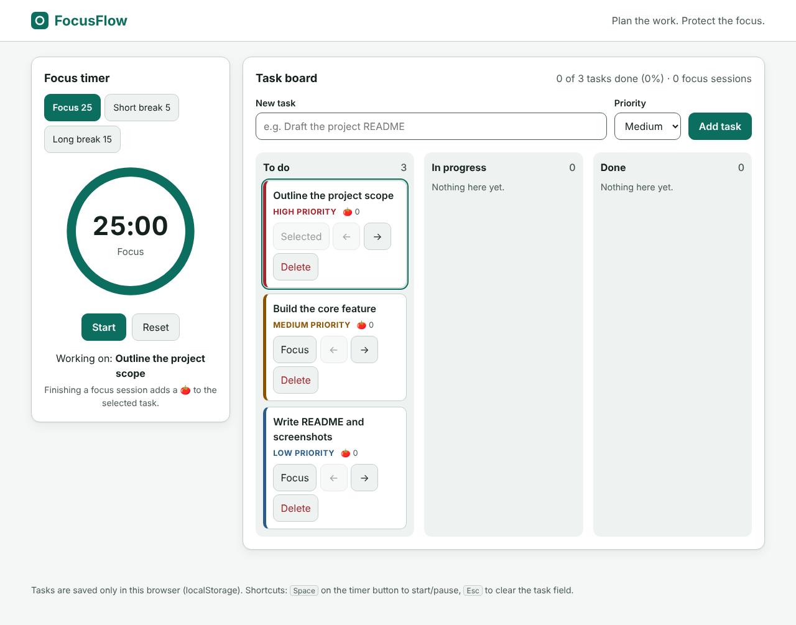
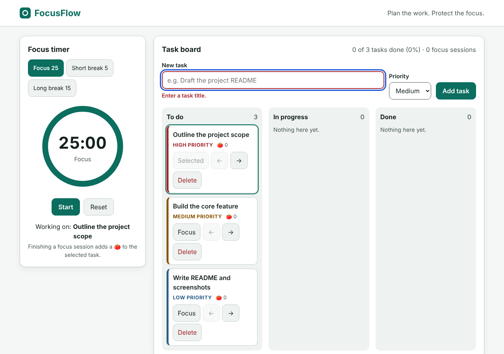
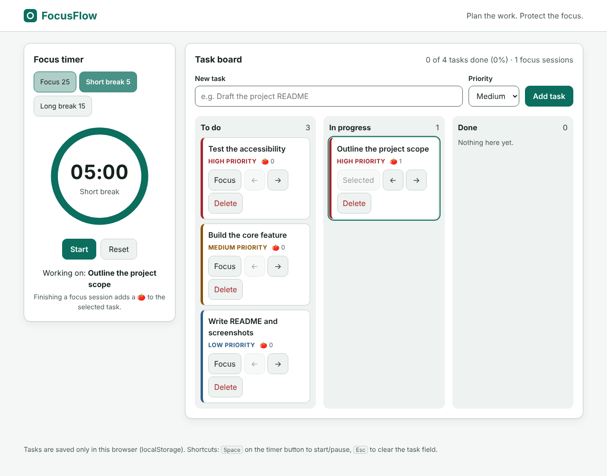
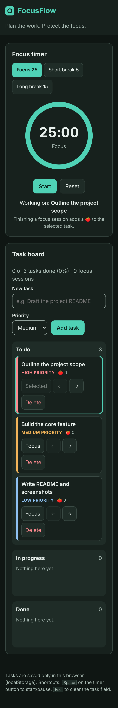

# FocusFlow: accessible task board with a focus timer

A small, dependency-free web app that combines a three-column task board (To do / In progress / Done) with a Pomodoro timer. Built with plain **HTML, CSS and JavaScript** and tested with **Browser DevTools-style checks in real Chrome**.

**Live project link:** _add your GitHub Pages / Netlify URL here after deploying (see "Deploy" below)_
**Repository:** _add your repo URL here_

---

## 1. Scope

**Problem.** Task lists and focus timers are usually separate tools, and many web versions are mouse-only, drag-and-drop-only, or low contrast. People who rely on a keyboard or screen reader end up with the worst experience.

**Target user.** A student or professional who wants one calm page to plan work and focus on it, including keyboard-only and screen-reader users.

**Required features**

| # | Feature |
|---|---------|
| F1 | Add tasks with title and priority, with inline validation |
| F2 | Move tasks between To do / In progress / Done using buttons (no drag-only interaction) |
| F3 | Delete tasks |
| F4 | Select one task as the timer's current task |
| F5 | Pomodoro timer: focus 25 / short break 5 / long break 15, start, pause, reset |
| F6 | Finishing a focus session credits a 🍅 to the selected task; every 4th focus gives a long break |
| F7 | Progress summary (tasks done, percent, sessions) |
| F8 | Data persists in `localStorage` and survives corrupt/blocked storage |
| F9 | Responsive layout, light and dark theme |

**Acceptance checklist** (all verified, see Evidence)

- [x] Everything works with the keyboard alone; a skip link is the first tab stop
- [x] All text ≥ 4.5:1 contrast and UI components/focus ring ≥ 3:1 in both themes
- [x] All buttons ≥ 44×44 CSS px
- [x] No horizontal scroll at 360px width
- [x] Status changes are announced via an `aria-live` region; the per-second countdown is *not* announced
- [x] Honors `prefers-reduced-motion` and `prefers-color-scheme`
- [x] User text is never inserted as HTML (no XSS)
- [x] No console errors; corrupt storage doesn't crash the app
- [x] Core logic covered by unit tests

---

## 2. Project structure

```
focusflow/
├── index.html          Semantic markup, landmarks, skip link, live region
├── styles.css          Design tokens, light/dark themes, responsive layout
├── logic.js            Pure functions (no DOM), unit-testable in Node
├── app.js              DOM rendering, events, timer, storage
├── tests/
│   ├── logic.test.js   12 unit tests (node:test)
│   ├── contrast.py     WCAG contrast checker over the CSS tokens
│   └── e2e.py          33 browser checks (Playwright + Chrome) + screenshots
├── evidence/           Test logs and screenshots
└── README.md
```

## 3. Setup and run

No build step and no dependencies.

```bash
# Option A: just open the file
open index.html            # or double-click it

# Option B: serve locally
python3 -m http.server 8000   # then visit http://localhost:8000
```

**Run the tests**

```bash
node --test tests/logic.test.js     # unit tests (Node 18+)
python3 tests/contrast.py           # WCAG contrast
pip install playwright && python3 tests/e2e.py   # browser checks (needs Chrome; adjust executable_path in the script)
```

**Deploy.** Push the folder to GitHub, then Settings → Pages → deploy from `main` / root. Paste the URL at the top of this file.

---

## 4. Key decisions and why

| Decision | Reason |
|----------|--------|
| **Move buttons instead of drag-and-drop** | Drag-and-drop fails WCAG 2.5.7 (Dragging Movements) for keyboard and many assistive-tech users. Buttons have explicit accessible names, e.g. "Move 'Draft README' to Done". |
| **Logic split from DOM (`logic.js`)** | Pure functions are trivial to test in Node and can't be broken by markup changes. All state updates return new arrays, never mutating input. |
| **Timer uses wall-clock `endsAt`, not counting ticks** | Browsers throttle `setInterval` in background tabs. Comparing against `Date.now()` keeps the timer accurate. |
| **Countdown is not a live region** | Announcing every second would make screen readers unusable. Only phase changes and task events go to the polite `#announcer`. |
| **Focus is restored after re-render** | Re-rendering the board would drop keyboard focus to `<body>`. `render()` remembers the focused button and restores it (WCAG 2.4.3). After delete, focus moves to the input. |
| **`textContent` / `createElement`, never `innerHTML`** | Task titles are untrusted input; this removes the XSS surface. Verified with an `` payload. |
| **`sanitizeTasks` on load** | `localStorage` can be hand-edited or corrupted; invalid entries are dropped rather than crashing the app. |
| **Colour tokens as CSS variables + automated contrast check** | Themes can't silently regress; `contrast.py` reads the real CSS and tests 18 pairs × 2 themes. |
| **Priority shown as text + colour** | Colour is never the only signal (WCAG 1.4.1). |
| **`novalidate` + custom error** | Native bubbles are inconsistent for screen readers; the custom message uses `role="alert"`, `aria-invalid` and `aria-describedby`, and moves focus to the field. |

---

## 5. Evidence

| Check | Result | File |
|-------|--------|------|
| Unit tests | **12 / 12 pass** | [`evidence/unit-tests.log`](evidence/unit-tests.log) |
| WCAG contrast (light + dark) | **36 / 36 pass** (lowest ratio 5.74:1) | [`evidence/contrast.log`](evidence/contrast.log) |
| Browser end-to-end (Chrome) | **33 / 33 pass** | [`evidence/e2e.log`](evidence/e2e.log) |

**Screenshots**

| Desktop, light | Validation error |
|---|---|
|  |  |

| After a focus session | Mobile 360px, dark |
|---|---|
|  |  |

### Manual checks you should still do before submitting
Automated checks can't replace these. Record what you find in the table below.

| Check | How | Result |
|-------|-----|--------|
| Lighthouse Accessibility / Best Practices | Chrome DevTools → Lighthouse | _fill in score_ |
| Screen reader pass | NVDA (Windows), VoiceOver (⌘F5 on macOS), or TalkBack | _notes_ |
| 200% / 400% zoom | Browser zoom; content should reflow with no loss | _notes_ |
| Keyboard walk-through | Unplug the mouse; add, move, focus, delete, run timer | _notes_ |

---

## 6. Known limitations

- Data lives only in one browser's `localStorage`; there is no sync or export.
- If the tab is closed, a running timer is lost (it does not resume).
- No sound or system notification at the end of a session; completion is announced to screen readers and shown visually only.
- Tasks can't be edited or reordered manually; order is by priority, then age.
- No automated screen-reader testing was done; the ARIA pattern is based on the guidance above and the Chrome accessibility checks, and needs a manual pass (see table).
- The e2e script expects Chrome at `/usr/bin/google-chrome`; change `executable_path` on other systems.

## 7. Ideas for next milestone

Edit-in-place for tasks, JSON export/import, optional end-of-session chime (off by default), persist the running timer across reloads, and a weekly focus-session history.

## 8. What I learned

Accessibility is mostly decisions made early: choosing buttons over drag-and-drop, restoring focus after a re-render, and keeping live regions quiet. Writing the contrast check as a script against the real CSS made theme changes safe to iterate on.
